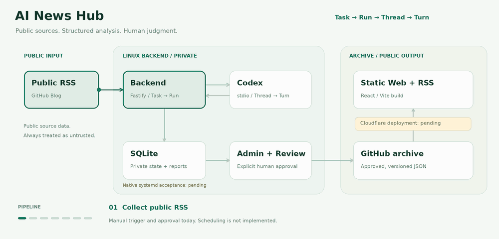

# AI News Hub

> 从真实 RSS 到可追溯日报：Codex 分析，人工审核，GitHub 归档，静态 Web / RSS 阅读。

**当前状态：手动端到端链路已实现并有真实调用记录；定时调度尚未实现，原生 Linux 服务账户/systemd 与 Cloudflare 自动部署仍待验收。**

运行目标为 **Linux，首选 Ubuntu Server 24.04 LTS**。本地管理后台可以先独立使用，公开站点部署不是运行 Backend 的前置条件。

## 架构一览



[查看静态架构图](docs/assets/architecture.svg) · [详细架构](docs/ARCHITECTURE.md)

**Task → Run → Thread → Turn**：会话、日志和结果都属于具体任务。Backend 管理采集、校验、状态和发布，Codex 负责分析；人工批准才允许归档。公开站只消费已批准的 JSON，SQLite、管理 Token 和运行日志留在私有服务侧。

## 已实现的能力

| 模块 | 当前范围 |
| --- | --- |
| Linux Backend | Node.js 22 / TypeScript、Fastify、私有 SQLite、追加式校验迁移、单实例锁、健康检查 |
| 任务引擎 | 手动触发、队列/并发限制、幂等、状态/历史/日志、取消、超时、重启中断；样例任务支持继续 Turn |
| Codex Adapter | stdio JSON-RPC、独立 Thread/Turn、只读沙箱、拒绝工具审批、子进程清理；过程消息与最终结果分离 |
| 新闻流水线 | 固定 GitHub Blog RSS、URL/时间规范化、最小去重、严格结构化分析、来源关联及待审核日报 |
| 管理后台 | 独立 React/Vite `/admin/`，查看任务与 Run、手动执行、日志、日报/来源预览及人工批准 |
| GitHub 归档 | 显式配置目标与凭据，按日期/频道/版本追加 JSON，保存 SHA，幂等及失败显式重试 |
| 公共阅读站 | 独立 React/Vite 静态首页、开源频道、详情、日期/版本归档、全站/频道 RSS；无 JS 也可阅读 |

当前只接入 `opensource` 频道与 GitHub Blog 来源。任务编辑、持久化定时调度、SSE、Agent 工具交互审批及更多频道仍在 [路线图](docs/ROADMAP.md) 中。

`validated` 仅代表结构和来源关联校验，`approved` 代表人工允许发布；两者都不等于独立事实核验。事实摘要、分析推断、来源发布时间、事件时间与抓取时间分开保存和展示，未知时间保留空值。

## 本地运行管理后台

准备非 root Linux 账户、Node.js **22.19.0 或更新的 22.x**，以及服务账户已认证的 Codex CLI：

```bash
npm ci --ignore-scripts
cp .env.example .env
```

编辑私有 `.env`：

- `AI_NEWS_HUB_DATA_DIR`：仓库外、当前用户拥有的绝对路径，目录权限 0700；不存在时自动创建。默认 `/var/lib/ai-news-hub` 用于正式服务账户。
- `AI_NEWS_HUB_ADMIN_TOKEN`：本机生成的 32–256 位字母/数字/下划线/连字符，可用 `openssl rand -hex 32`；不要提交真实值。
- `AI_NEWS_HUB_CODEX_BIN`：当前账户可执行的 Codex CLI 路径。

```bash
npm run build
npm start
```

打开 **http://127.0.0.1:3000/admin/**，输入管理 Token。Token 仅保存在页面内存，刷新需重输；服务端历史保存在 SQLite。管理 API 只允许回环地址，未配置 Token 时关闭。

手动运行 `sample-connectivity` 验证接入，或运行 `news-github` 采集并生成待审核日报；真实调用会使用账户额度。新闻任务需新建 Run 重新分析，不支持继续 Turn。审核后可单独批准、归档；发布默认关闭，配置见 [GitHub 归档](docs/PUBLISHING.md)。

`npm run health` 检查本地服务/数据库，不验证 Codex 登录或额度。启动自动迁移，也可显式运行 `npm run db:migrate`；失败不清空旧库。SQLite 使用 Node 22 内置实验性 `node:sqlite`，保留其提示。

## 构建公共站

```bash
# 正式构建：读取当前 checkout 的 reports/，无数据时展示空状态
SITE_URL=https://your-project.pages.dev npm run build:web

# 显式演示：两个日期的测试样本，页面/RSS 标记 DEMO
npm run build:web:demo
```

唯一公开输出是 **`dist/web`**。`dist/admin`、`dist/apps` 与构建用的 `dist/web-render` 都不能上传到公开站。生成后的 HTML、静态数据与 RSS 不依赖 Backend 在线。

Cloudflare Pages 的 GitHub 授权、HTTPS 与自动构建尚待实际验收，不能把本地构建成功当作已经上线。构建命令、输出目录、`SITE_URL`、Private Repo 和跨分支归档约束见 [公共站与部署](docs/PUBLIC_WEB.md)。

## 工程结构与检查

```text
apps/server/src/       Backend、任务引擎、Codex Adapter、SQLite、采集与归档
apps/admin/            私有管理后台
apps/web/              公共阅读组件与独立静态生成器
packages/shared/src/   共享接口、状态与 Agent 环境白名单
tools/codex-probe/     独立接入诊断工具
scripts/               健康检查、服务操作与架构图生成
prototype/             独立 HTML 设计原型，全部为模拟交互
```

```bash
npm run lint
npm run typecheck
npm test
npm run build
```

`npm test` 包含 Backend、Admin 与公共站的模拟测试/静态构建，会启动回环 HTTP 和模拟子进程，不访问真实新闻源或模型。构建 Backend/Admin 与构建公共站是两个独立入口。

开发工具链以 `overrides` 固定 minimatch 11.0.1，处理 [GHSA-g3hv-75wg-m249](https://github.com/advisories/GHSA-g3hv-75wg-m249)；后续更新依赖时应重新评估。架构图资源及可复现生成方式见 [资源说明](docs/assets/README.md)。

## 文档与验收

| 内容 | 文档 |
| --- | --- |
| 架构与数据边界 | [ARCHITECTURE](docs/ARCHITECTURE.md)、[DATA_MODEL](docs/DATA_MODEL.md) |
| Linux 安装、systemd 与认证 | [DEPLOY_LINUX](docs/DEPLOY_LINUX.md) |
| 任务 API / 管理后台 | [TASK_ENGINE](docs/TASK_ENGINE.md)、[ADMIN](docs/ADMIN.md) |
| RSS 采集与报告 / GitHub 归档 | [NEWS_PIPELINE](docs/NEWS_PIPELINE.md)、[PUBLISHING](docs/PUBLISHING.md) |
| 静态站、RSS 与 Pages 配置 | [PUBLIC_WEB](docs/PUBLIC_WEB.md) |
| 计划和 UI | [ROADMAP](docs/ROADMAP.md)、[UI_DESIGN_SPEC](docs/UI_DESIGN_SPEC.md)、[原型](prototype/README.md) |

真实开发验证记录包括 [Codex 探针](docs/validation/CODEX_LINUX_PROBE.md)、[任务引擎](docs/validation/TASK_ENGINE.md)、[新闻流水线](docs/validation/NEWS_PIPELINE.md)、[管理后台](docs/validation/ADMIN.md)、[归档](docs/validation/PUBLISHING.md) 与 [公共站](docs/validation/PUBLIC_WEB.md)。它们的日期、环境和范围各自注明；原生服务器长期认证与 systemd 验收仍由 [#2](https://github.com/SwartzMss/ai-news-hub/issues/2) 跟踪，Cloudflare 上线由 [#8](https://github.com/SwartzMss/ai-news-hub/issues/8) 跟踪。

## 数据与安全

- 非 root、最小权限；Backend 和 Agent RPC 不默认开放公网。
- 发布凭据只在 Backend 运行时配置，不继承给 Codex；管理 Token 不进入浏览器持久存储。
- SQLite、OAuth 凭据、Cookie、代理配置和私密运行日志不入 Git，不导出到公开站。
- 无有效来源不发布；原文更正刷新当前来源，已生成报告与候选快照保留历史。
- GitHub 只归档人工允许发布的内容；公共页面清楚标注来源与推断，不伪造评论、点赞或热度。

## License

**待确定。** 尚未添加许可证；在明确选择开源协议前，不应假定已授予额外复制、修改或分发权限。
