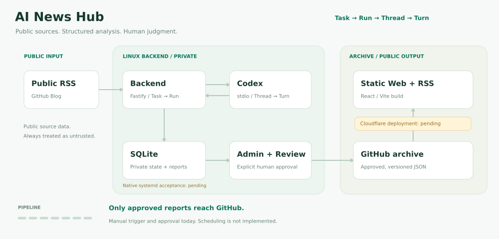

# 架构与实现边界

AI News Hub 采用 **Linux 单实例执行、Codex 主题研究、人工审核、GitHub 归档与静态公开站**。目前手动操作；持久调度、自动重试、原生 Ubuntu Server 24.04 服务账户/systemd 验收及 Cloudflare 上线尚未完成。



动画与源码见 [资源说明](assets/README.md)。

## 输入与数据流

```text
主题 + 初始 prompt → Task / 新 Run / 新 Thread
  → Codex 实时搜索、打开原文、提取和分析
  ↔ 用户多轮 prompt / 同 Thread 新 Turn
  → 显式生成 JSON → Backend 核对原文、引文和结构
  → SQLite 待审核日报 → 人工批准 → GitHub 版本 JSON
  → 独立静态 Web + 输出 RSS → Cloudflare Pages（上线待验收）
```

Codex 选择和提取新闻来源；Backend 只核对选定原文，并控制执行、存储及发布。没有外部 RSS 候选入口。当前任务 `news-research`；旧 `news-github` 停用，仅保留历史。

## 模块职责

| 模块 | 当前职责 |
| --- | --- |
| Task Engine | 手动队列、同任务互斥、幂等、历史、取消/超时、重启中断 |
| Codex Adapter | stdio JSON-RPC、Thread/Turn 归属、受控搜索、终态和进程回收 |
| News Workflow | 主题/多轮 prompt、显式最终 Schema、验证后原子保存 |
| Source verifier | 公网 HTTPS、DNS 固定连接、HTML 解析、精确引文和源元数据 |
| SQLite | 私有历史/正文、来源快照、报告、批准和归档记录 |
| Admin | 主题/prompt、继续研究、生成、日志、来源审核、独立批准和归档 |
| Publisher | 哈希批准、严格 archive v1、GitHub 追加文件、显式重试 |
| Public Web | 读取 approved 归档构建实际 HTML 路由/RSS，不读取 Backend 或 SQLite |

## Task / Run / Thread / Turn

每个 Run 新建 Thread，每轮启动新的 stdio App Server 子进程。握手、读取账户后，新闻轮读取有效配置并禁用继承的 MCP，再创建/恢复 Thread 和启动 Turn。一个 Run 最多 20 轮，日志/会话/结果都属于任务，没有独立 Agent 工作台。

只有匹配 Thread/Turn 的 completed、非空最终输出及确认进程清理才能成功。commentary/partial_answer 仅作过程日志，优先使用 final_answer，缺失时兼容未标记/未知 phase。研究轮保存文本；最终生成还需来源校验和事务保存。生成成功后 Run 固定，修改须新建研究；失败可在原 Thread 修正。

报告、文章关联、快照与 Run/Turn 成功一起提交；取消/超时不写迟到成功。关闭中断工作并回收进程组，清理不确定时以 cleanup_failed 停止引擎。重启将未完成状态标 interrupted，不自动重跑。PID/启动时间/boot ID 保证同一数据目录只允许一个 Backend。

独立探针 `tools/codex-probe/` 用于最小认证/协议诊断，不替代业务链路。接口和配额见 [任务引擎](TASK_ENGINE.md)。

## 搜索与验证边界

新闻 Thread 使用 hosted live web search、只读沙箱和 untrusted 审批；禁用 Shell、应用、委派及逐个继承的 MCP。工具事件仅放行 webSearch，审批一律拒绝。服务账户 HOME/Codex 认证仍需保护；Backend 凭据不得位于 Agent 可读取的工作目录或认证目录。

研究轮返回文本与链接。最终轮输出 URL、来源归属摘要、推断和精确引文，Backend 请求选定公开 HTTPS 原文，验证全部 DNS 地址并固定连接；不跟随重定向、不继承代理/Cookie/认证。每页 15 秒/2 MiB，仅 UTF-8 HTML，不执行脚本。URL、发布时间、事件时间与抓取时间独立保存，未知为 null。最多 10 条，按 canonical URL 去重，不自动合并跨来源事件。

validated/source_only 只表示结构与引文关联，仍需人工核对摘要、事实和时效。后续文章更新不能改写历史快照。详见 [新闻研究](NEWS_PIPELINE.md)。

## 存储、迁移与归档

SQLite 在 Linux 持久目录（如 `/var/lib/ai-news-hub`），目录 0700、数据库 0600，启用外键/WAL/busy timeout。迁移只追加，核对 checksum，冲突必须失败，不能删库规避。

迁移 1 为基础数据，2 为执行历史/锁，3 的 RSS 表仅留历史，4 为批准/归档；5 新增 codex_news_runs、Turn mode 并停用旧 RSS 任务；6 新增数据库设置、管理员凭据和会话。归档 v1 保持 `opensource` 频道键，主题可自由填写；新发布频道另行扩展合同。

人工批准绑定文档、版本、来源快照和关联 ID 哈希；原始生成文档仍为 pending。发布重新核对成功 Run 和快照，archive v1 不导出 Run/Thread、日志、SQLite 或凭据。Markdown 仅留 SQLite。

GitHub 路径 `reports/YYYY/MM/DD/opensource/vNNNNNN.json` 只追加；相同字节复用提交，不同字节拒绝。网络不占事务，发布串行；响应丢失后显式重试。repository/branch/token 由受保护后台显式配置到 SQLite，默认关闭。见 [数据模型](DATA_MODEL.md)、[归档协议](PUBLISHING.md)。

## 管理和公开站

Admin 独立构建到 dist/admin，Backend 只提供 `/admin/` 壳和有限 JS/CSS，私有读写均经 Bearer `/api`。初始化后用密码登录，临时 Bearer 会话仅在页面内存，刷新重新认证。每 2 秒顺序轮询，导航/退出中断旧请求。研究请求保存页面内幂等 payload，不确定时锁定输入并重试原请求；刷新后先查历史。

公开站唯一输出 dist/web，构建模块 dist/web-render 不公开。正式构建读取 checkout 的 approved reports/；无数据为空状态；demo 独立并标记 DEMO/noindex，正式拒绝测试标记。HTML 包括首页、频道、来源详情、日期/版本页；无 JS 可阅读，浏览器脚本仅切主题。同日最高版本进入列表，历史页保留版本。

输出 `/rss/all.xml`、`/rss/opensource.xml`，正确转义 XML、稳定 GUID、首次批准 pubDate。公共产物不依赖 Backend 在线。Cloudflare Git 授权/HTTPS/自动部署待验收，只上传 dist/web。见 [后台](ADMIN.md)、[公共站](PUBLIC_WEB.md)。

## Linux 安全与未完成事项

部署目标 Linux，首选 Ubuntu Server 24.04 LTS；Node.js 22 / TypeScript Backend 由 systemd 管理。Agent RPC 只用 stdio，不开放网络端口。管理 API 仅回环，未初始化管理员则关闭业务接口；health 只检查服务/Schema，不验证 Codex 登录。

Agent 与探针使用环境允许列表，不继承 Backend 管理/发布凭据。来源校验直接连接无代理；GitHub 客户端可使用服务端私有代理。日志不输出请求头/正文、原始 RPC/stderr、工具参数或任意错误。凭据、SQLite 和私人日志不得入 Git 或公开站。

原生服务账户认证/systemd/长期使用由 #2 跟踪，Cloudflare 由 #8 跟踪。持久调度、自动退避、SSE、工具审批交互、跨源事实核验尚未实现。见 [部署](DEPLOY_LINUX.md)、[路线图](ROADMAP.md)。

环境文件仅提供监听地址、端口和数据目录。运行参数由系统设置页保存 SQLite，空闲时立即应用；任务/归档忙碌时拒绝修改。GitHub Token 以 AES-GCM 加密，私有 settings.key 自动生成，API 仅返回是否配置。首次本机一次性码建立 scrypt 管理密码，DB 保存会话哈希/到期时间，改密码撤销旧会话。旧环境配置只在记录缺失时导入，之后数据库优先。见 [设置与认证](SETTINGS.md)。
